# Missed Questions Log

Log every question missed **or guessed**. Write the "why" in your own words — never paste Boson question text.
Status: `Review` → `Got it` once answered correctly in a later drill.

**Before each checkpoint exam:** filter for `Review` rows (Ctrl+F) and re-read only those.

---

## Score history

| Date | Session | Mode | Score | Notes |
|------|---------|------|-------|-------|
| 2026-10-24 | Exam A baseline | Simulation | | |

---

## Network Fundamentals (20%)

| Date | Topic | What I picked | Why the right answer is right | Status |
|------|-------|---------------|-------------------------------|--------|
| | | | | |

## Network Access (20%)

| Date | Topic | What I picked | Why the right answer is right | Status |
|------|-------|---------------|-------------------------------|--------|
| | | | | |

## IP Connectivity (25%)

| Date | Topic | What I picked | Why the right answer is right | Status |
|------|-------|---------------|-------------------------------|--------|
| | | | | |

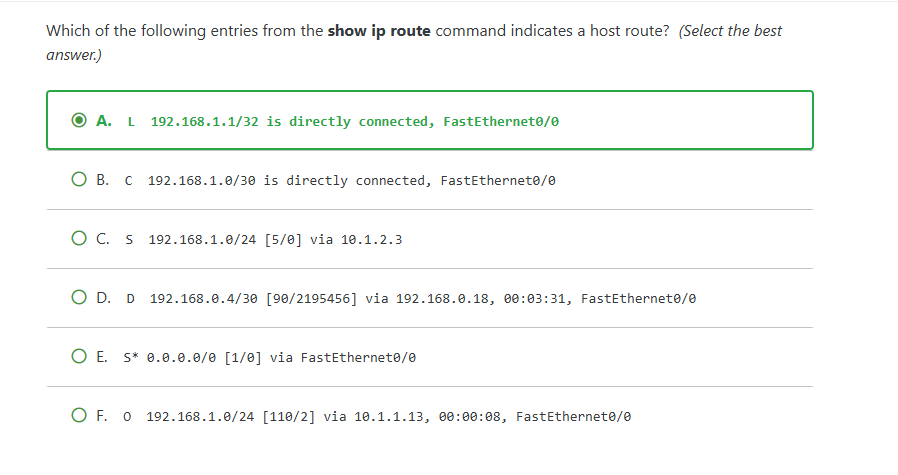

- i got it correct but i guest. The answer is "A" because it is a local host route. These are usually marked with an L in the output of the show ip route command. Internal protocol IPV4 host routes have a /32 mask and for IPV6 host routes have /128 mask.

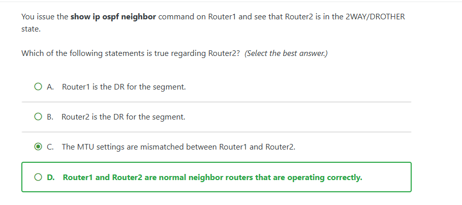

- i guessed and got this one wrong. The 2WAY/DROTHER output shows that both routers are normal neighbor routers that are operating correctly. Routers that are are neitehr the DR or BDR remain in the 2 way state. The DR and BDR will proceed in full state.

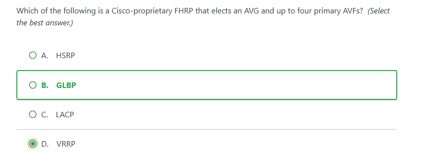

- I also guessed on this one. this section is probably the hardest part of the ccna IMO. But anyways time to read the explanation. gateway Load Balancing protocol (GLBP) is a cisco proprietery first hop redundency protocol (FHRP) that elects an active virtual gateway (AVG) and up to four primary active virtual forwarders (AVFs). FHRPs are layer 3 protocol used to provide layer 3 redundency such as fail over and load balancing. Ensures a backup path to external netowrks should a primary path fail or become congested. 

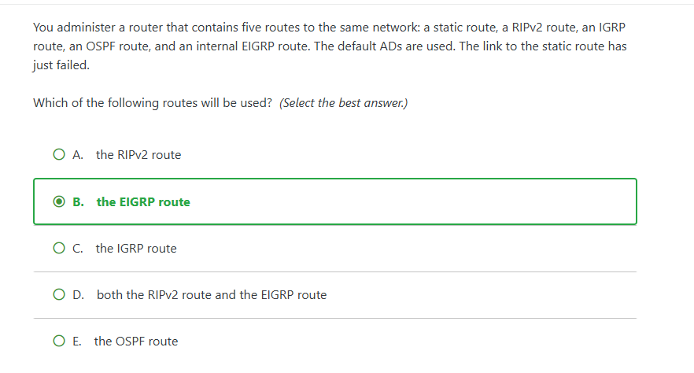
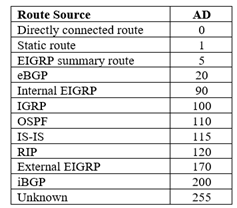

- this one i got right and didnt really guess. I remembered that EIGRP had one of the lowest AD value and assumed it would be the next best route. The enhanced interior gateway routing protocol (EIGRP) route will be used when the link to the static route goes down. When multiple routes to a netowrk exist and each route uses different routing protocol, a router prefers the routing protocol with the lowest administractive distance (AD). Will show chart above

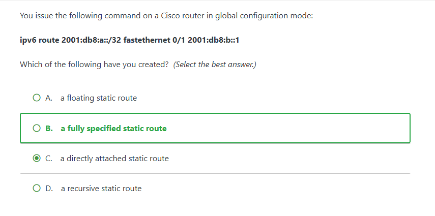

- honestly had no idea what the answer was. A fully specified static route is an ipv6 static route in which the destination network, outbound interface, and next hop ipv6 address are all configured directly. 

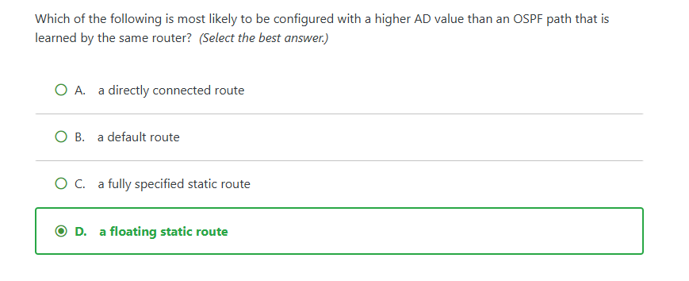

- I got this one right thanks to reading one of the old question summary. The floating route is used as a backup so its always going to have a higher AD value. This ensures that the routing protocol path is always selected by the router unless the path becomes unavailable. 

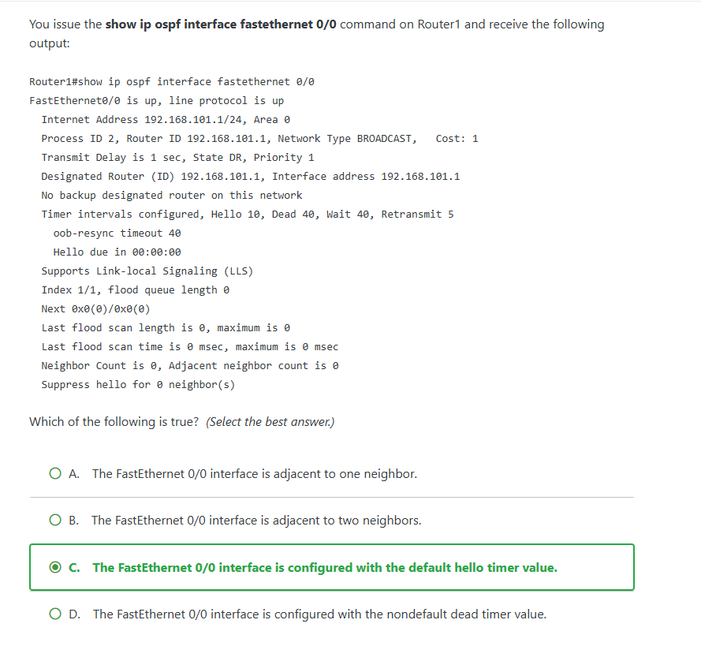

- This one was pretty straightfoward. Just need to read the commands. The hello timer by default is set to 10 sec on OSPF. This OSPF interface has no neighbors and has the default dead timer value. 

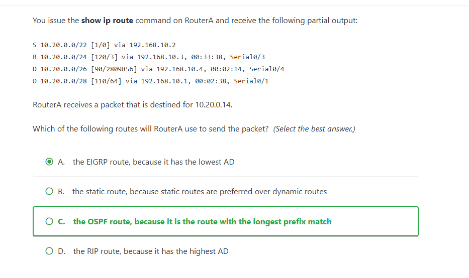

- kinda just guessed on this one. the path will take the OSPF route because it is the route with the longest prefix which includes destinations addresses 10.20.0.0 through 10.20.0.15

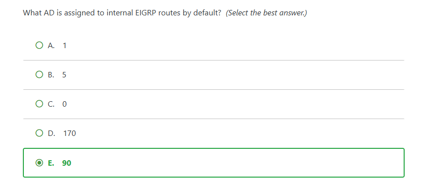

thhis one was pretty straight forward. We have been looking at multiple charts of route sourece and AD values. EIGRP AD value is 90.

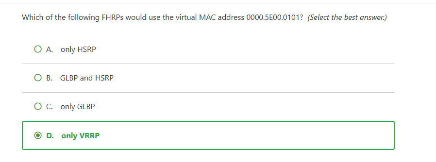

- Im not gonna lie i guessed on this but i got it correct. Supported by both cisco and non cisco devices. The virtual mac address for VRRP groups is in the form of 0000.5E00.01xx, where xx is a hexadecimal value identifying the VRRP group number. 

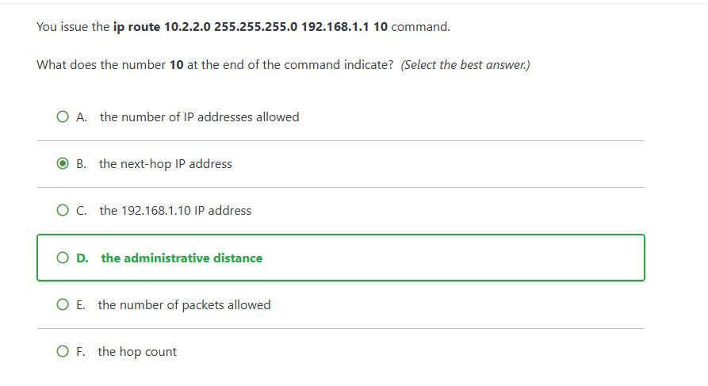

- Also guessed like an idiot on this one. The number 10 at the end of the command indicates the administrative distance for the route. 

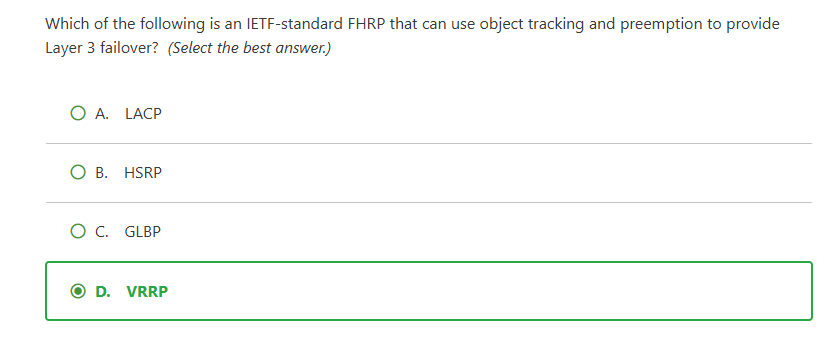

- finally didnt guess. The only IETF- Standard FHRP is VRRP. It can use object tracking and preemption to provide layer 3 failover. 
-----------------------------------------------------------
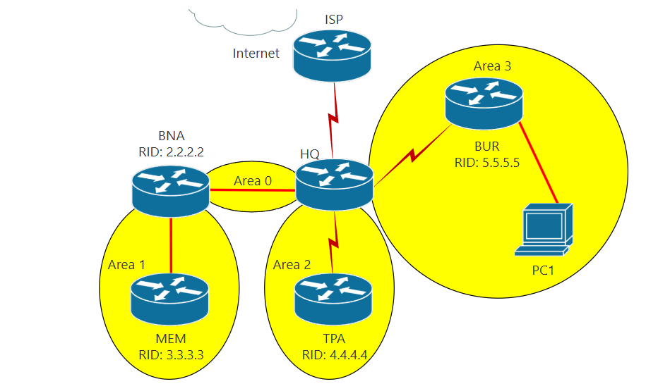

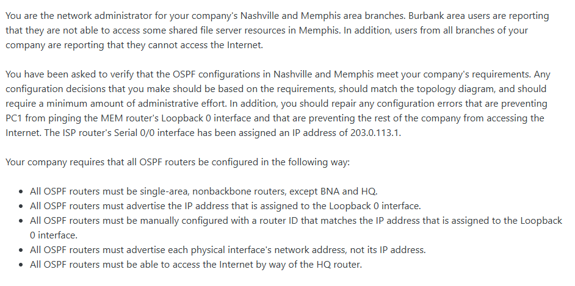

step 1: gather facts on each router. 

HQ: 

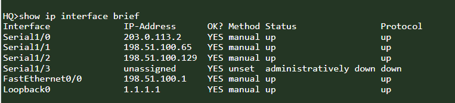

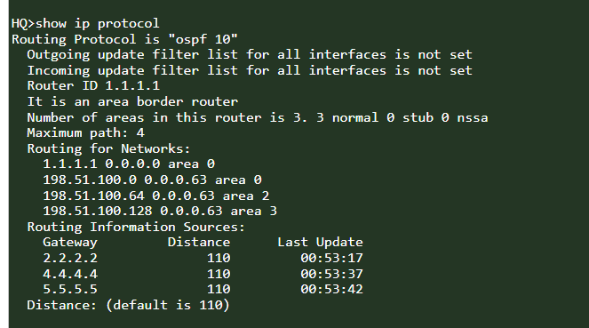

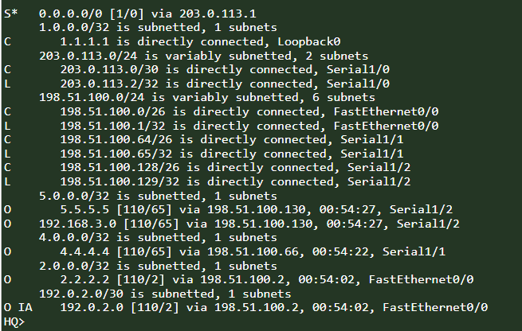

BNA:

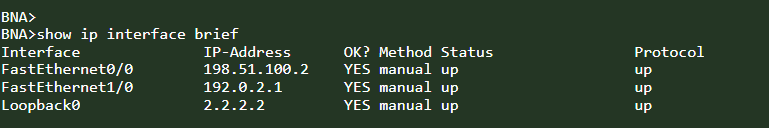

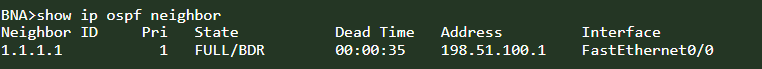

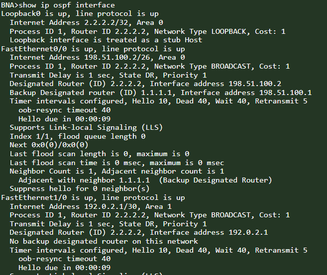

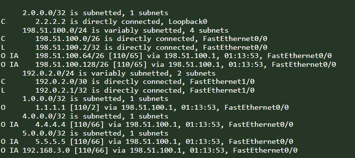

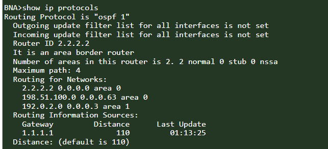

------------------------------------------
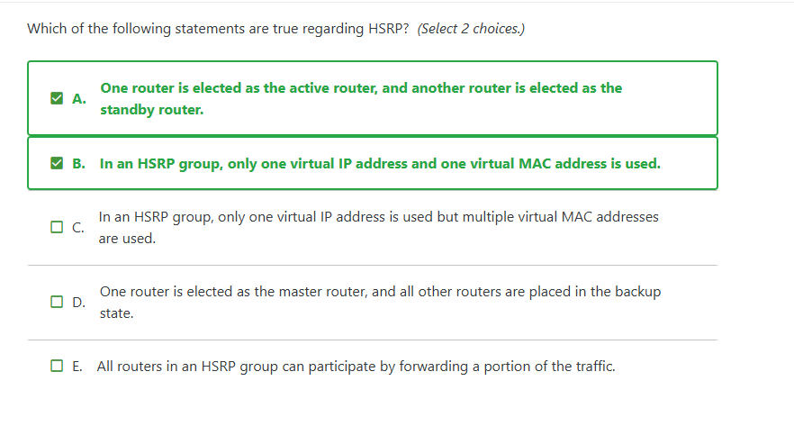

HSRP elects one router as a standy router  and only one virtual internet protocol address and one virtual media access control address is used.

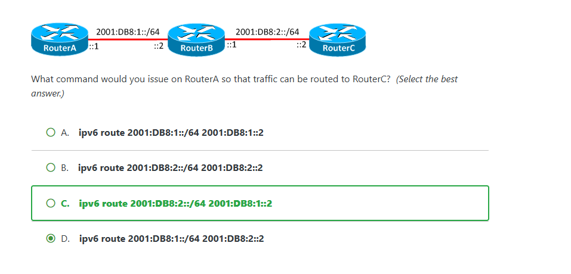

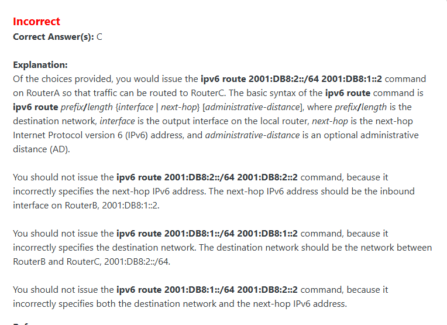

- ipv6 route prefix/length {interface | next-hop} [administrative-distance], where prefix/length is the destination network, interface is the output interface on the local router.

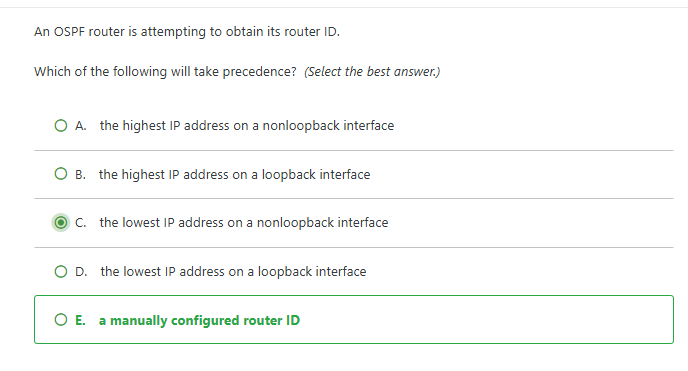

- always a manually configured router ID will take precedence over any form of automatically calculated router ID on OSPF router. If the OSPF router ID of a router is not manually configured, the router ID will be determined first by the highest internet protocol address among loopback interfaces and then by the highest IP address among physical interfaces if no loopback has been configured. 

## IP Services (10%)

| Date | Topic | What I picked | Why the right answer is right | Status |
|------|-------|---------------|-------------------------------|--------|
| | | | | |

## Security Fundamentals (15%)

| Date | Topic | What I picked | Why the right answer is right | Status |
|------|-------|---------------|-------------------------------|--------|
| | | | | |

## Automation and Programmability (10%)

| Date | Topic | What I picked | Why the right answer is right | Status |
|------|-------|---------------|-------------------------------|--------|
| | | | | |
