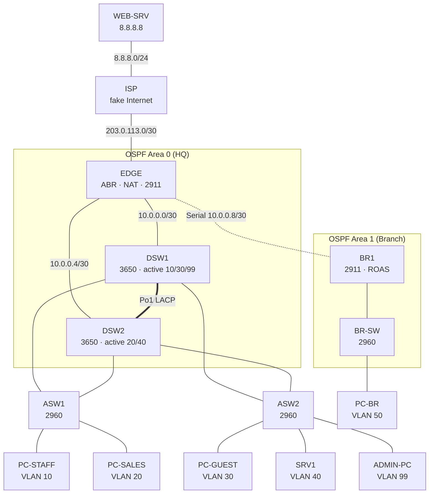

# CCNA Capstone Lab: HQ + Branch Network in Packet Tracer

After finishing the CCNA course, I wanted to prove to myself that I could design and build a network from a blank canvas, not just follow pre-made labs. This lab is my capstone. It's one network, an HQ campus plus a branch office with an Internet edge, that I build in phases until it covers every major CCNA 200-301 topic. Then I break it on purpose and fix it.

**Tools:** Cisco Packet Tracer · **Exam:** CCNA 200-301

## Progress

- [ ] Phase 1: Base config and device hardening
- [ ] Phase 2: VLANs, trunks, EtherChannel, Rapid PVST+
- [ ] Phase 3: Inter-VLAN routing (SVIs + HSRP, router-on-a-stick)
- [ ] Phase 4: Multi-area OSPF and default route
- [ ] Phase 5: DHCP, DHCP relay, DNS
- [ ] Phase 6: NAT/PAT and Internet access
- [ ] Phase 7: Layer 2 security
- [ ] Phase 8: ACLs
- [ ] Phase 9: NTP, syslog, SNMP, CDP/LLDP
- [ ] Phase 10: IPv6
- [ ] Phase 11: Break/fix drills

## Topology



<!-- Replace or supplement with a screenshot of the real canvas:  -->

### Design decisions

- **ISP** simulates the Internet. It has one web server at 8.8.8.8 and no routes to my private 10.x space, so Internet access only works if my NAT works.
- **EDGE** is my Internet edge: PAT, a static default route, and the OSPF ABR between HQ (area 0) and the branch (area 1).
- **DSW1 / DSW2** are my HQ distribution pair: SVIs, HSRP, an LACP EtherChannel between them, and STP root roles split per VLAN. Each switch is STP root for the same VLANs where it's the HSRP active router, so traffic never takes a detour.
- **ASW1 / ASW2** are dual-homed to both distribution switches, which creates the redundant loops STP has to block.
- **BR1 + BR-SW** make up the branch: router-on-a-stick, a local DHCP pool, and a serial WAN link back to EDGE.
- **SRV1** is my central DHCP, DNS, NTP and syslog server.

### CCNA coverage

| Phase | Topics |
| --- | --- |
| 1 | Device hardening, SSH, local AAA, banners |
| 2 | VLANs, 802.1Q trunks, native VLAN, DTP, VTP, LACP EtherChannel, Rapid PVST+, PortFast |
| 3 | SVIs, HSRP, router-on-a-stick |
| 4 | Multi-area OSPFv2, router IDs, passive interfaces, default-route injection |
| 5 | DHCP server, DHCP relay, DNS |
| 6 | PAT / NAT overload |
| 7 | Port security, DHCP snooping, DAI, BPDU guard |
| 8 | Standard and extended ACLs, VTY ACL |
| 9 | NTP, syslog, SNMP, CDP/LLDP |
| 10 | IPv6 addressing, SLAAC, IPv6 static and default routes |
| 11 | Troubleshooting (break/fix) |

## Devices and cabling

| Device | PT model | Module I added |
| --- | --- | --- |
| ISP | 2911 | none |
| EDGE | 2911 | HWIC-2T in slot 0 (serial) |
| BR1 | 2911 | HWIC-2T in slot 0 |
| DSW1, DSW2 | 3650-24PS | AC-POWER-SUPPLY (the 3650 doesn't boot without it) |
| ASW1, ASW2, BR-SW | 2960-24TT | none |
| WEB-SRV, SRV1 | Server-PT | none |
| PC-STAFF, PC-SALES, PC-GUEST, ADMIN-PC, PC-BR | PC-PT | none |

| From | Port | To | Port | Link |
| --- | --- | --- | --- | --- |
| ISP | G0/0 | EDGE | G0/0 | Internet uplink |
| ISP | G0/1 | WEB-SRV | Fa0 | "Internet" server |
| EDGE | G0/1 | DSW1 | G1/0/1 | Routed uplink |
| EDGE | G0/2 | DSW2 | G1/0/1 | Routed uplink |
| EDGE | S0/0/0 | BR1 | S0/0/0 | WAN, EDGE = DCE |
| DSW1 | G1/0/23–24 | DSW2 | G1/0/23–24 | EtherChannel Po1 |
| DSW1 | G1/0/2 | ASW1 | G0/1 | Trunk |
| DSW2 | G1/0/2 | ASW1 | G0/2 | Trunk |
| DSW1 | G1/0/3 | ASW2 | G0/1 | Trunk |
| DSW2 | G1/0/3 | ASW2 | G0/2 | Trunk |
| ASW1 | Fa0/1 | PC-STAFF | Fa0 | VLAN 10 |
| ASW1 | Fa0/2 | PC-SALES | Fa0 | VLAN 20 |
| ASW2 | Fa0/1 | PC-GUEST | Fa0 | VLAN 30 |
| ASW2 | Fa0/2 | SRV1 | Fa0 | VLAN 40 |
| ASW2 | Fa0/24 | ADMIN-PC | Fa0 | VLAN 99 |
| BR1 | G0/0 | BR-SW | G0/1 | Trunk (ROAS) |
| BR-SW | Fa0/1 | PC-BR | Fa0 | VLAN 50 |

## IP addressing plan

HQ uses 10.10.0.0/16, the branch uses 10.20.0.0/16, and my point-to-point links are /30s out of 10.0.0.0/24. Every gateway is .1. At HQ, .1 is the HSRP virtual IP, DSW1 takes .2 and DSW2 takes .3.

### HQ VLANs

| VLAN | Name | Subnet | Gateway (HSRP VIP) | DSW1 / DSW2 | HSRP active | DHCP range |
| --- | --- | --- | --- | --- | --- | --- |
| 10 | STAFF | 10.10.10.0/24 | 10.10.10.1 | .2 / .3 | DSW1 | .100–.199 |
| 20 | SALES | 10.10.20.0/24 | 10.10.20.1 | .2 / .3 | DSW2 | .100–.199 |
| 30 | GUEST | 10.10.30.0/24 | 10.10.30.1 | .2 / .3 | DSW1 | .100–.199 |
| 40 | SERVERS | 10.10.40.0/24 | 10.10.40.1 | .2 / .3 | DSW2 | static |
| 99 | MGMT | 10.10.99.0/24 | 10.10.99.1 | .2 / .3 | DSW1 | static |
| 666 | BLACKHOLE | none | none | none | none | unused ports |
| 999 | NATIVE | none | none | none | none | trunk native only |

### Branch VLANs

| VLAN | Name | Subnet | Gateway | DHCP |
| --- | --- | --- | --- | --- |
| 50 | BR-USERS | 10.20.50.0/24 | 10.20.50.1 (G0/0.50) | BR1 pool, .11–.254 |
| 98 | BR-MGMT | 10.20.98.0/24 | 10.20.98.1 (G0/0.98) | static |

### Point-to-point links

| Link | Subnet | Addresses |
| --- | --- | --- |
| ISP – EDGE | 203.0.113.0/30 | ISP .1, EDGE .2 |
| EDGE – DSW1 | 10.0.0.0/30 | EDGE .1, DSW1 .2 |
| EDGE – DSW2 | 10.0.0.4/30 | EDGE .5, DSW2 .6 |
| EDGE – BR1 | 10.0.0.8/30 | EDGE .9, BR1 .10 |
| ISP – WEB-SRV | 8.8.8.0/24 | ISP .1, WEB-SRV .8 |

### Loopbacks and static hosts

| Device | Address | Notes |
| --- | --- | --- |
| EDGE Lo0 | 1.1.1.1/32 | OSPF router ID |
| DSW1 Lo0 | 2.2.2.2/32 | OSPF router ID |
| DSW2 Lo0 | 3.3.3.3/32 | OSPF router ID |
| BR1 Lo0 | 4.4.4.4/32 | OSPF router ID |
| SRV1 | 10.10.40.10/24, gw .1 | DHCP, DNS, NTP, syslog |
| ASW1 / ASW2 | 10.10.99.11 / .12, gw .1 | Management SVI |
| ADMIN-PC | 10.10.99.50, gw .1 | Static |
| BR-SW | 10.20.98.11, gw .1 | Management SVI |

---

## Phase 1: Base config and hardening

I applied this baseline to every network device, changing the hostname each time.

```
enable
configure terminal
hostname EDGE
no ip domain-lookup
ip domain-name lab.local
enable secret Cisco123!
service password-encryption
username admin privilege 15 secret Admin123!
banner motd # Authorized access only #
!
line console 0
 login local
 logging synchronous
 exec-timeout 10 0
!
crypto key generate rsa general-keys modulus 2048
ip ssh version 2
!
line vty 0 4          ! 0 15 on switches
 login local
 transport input ssh
 exec-timeout 10 0
end
copy running-config startup-config
```

> These are lab-only passwords. I'd never reuse them on real gear.

My Layer 2 switches need a management SVI and a default gateway:

```
! ASW1 (ASW2 = .12; BR-SW = 10.20.98.11, gw 10.20.98.1, VLAN 98)
vlan 99
 name MGMT
interface vlan 99
 ip address 10.10.99.11 255.255.255.0
 no shutdown
ip default-gateway 10.10.99.1
```

Router interfaces and loopbacks:

```
! ISP
interface g0/0
 ip address 203.0.113.1 255.255.255.252
 no shutdown
interface g0/1
 ip address 8.8.8.1 255.255.255.0
 no shutdown

! EDGE
interface loopback0
 ip address 1.1.1.1 255.255.255.255
interface g0/0
 ip address 203.0.113.2 255.255.255.252
 no shutdown
interface g0/1
 ip address 10.0.0.1 255.255.255.252
 no shutdown
interface g0/2
 ip address 10.0.0.5 255.255.255.252
 no shutdown
interface s0/0/0
 ip address 10.0.0.9 255.255.255.252
 clock rate 64000      ! DCE end only
 no shutdown

! BR1
interface loopback0
 ip address 4.4.4.4 255.255.255.255
interface s0/0/0
 ip address 10.0.0.10 255.255.255.252
 no shutdown
```

I set WEB-SRV to 8.8.8.8/24 (gateway 8.8.8.1) and SRV1 to 10.10.40.10/24 (gateway 10.10.40.1, DNS 10.10.40.10).

**How I verified it:** `show ip interface brief` · `show controllers s0/0/0` (DCE cable on EDGE) · ping across the serial link and to ISP · `show ip ssh`

---

## Phase 2: VLANs, trunks, EtherChannel, Rapid PVST+

On all four HQ switches, I used VTP transparent mode so a VTP mistake can't wipe my VLANs:

```
vtp mode transparent
vlan 10
 name STAFF
vlan 20
 name SALES
vlan 30
 name GUEST
vlan 40
 name SERVERS
vlan 99
 name MGMT
vlan 666
 name BLACKHOLE
vlan 999
 name NATIVE
spanning-tree mode rapid-pvst
```

LACP EtherChannel between DSW1 and DSW2. The 3650 supports ISL, so it needs `encapsulation dot1q` before it will trunk:

```
interface range g1/0/23 - 24
 switchport trunk encapsulation dot1q
 switchport mode trunk
 channel-group 1 mode active
interface port-channel 1
 switchport trunk encapsulation dot1q
 switchport mode trunk
 switchport trunk native vlan 999
 switchport trunk allowed vlan 10,20,30,40,99
 switchport nonegotiate
```

Trunk downlinks use the same settings on DSW G1/0/2–3 and ASW G0/1–2. The 2960s don't take the encapsulation line.

```
interface range g1/0/2 - 3
 switchport trunk encapsulation dot1q
 switchport mode trunk
 switchport trunk native vlan 999
 switchport trunk allowed vlan 10,20,30,40,99
 switchport nonegotiate
```

Root bridge placement, aligned with HSRP:

```
! DSW1
spanning-tree vlan 10,30,99 root primary
spanning-tree vlan 20,40 root secondary
! DSW2
spanning-tree vlan 20,40 root primary
spanning-tree vlan 10,30,99 root secondary
```

Access ports (ASW1 shown). Every unused port is shut down and parked in VLAN 666:

```
interface fa0/1
 switchport mode access
 switchport access vlan 10
 spanning-tree portfast
 spanning-tree bpduguard enable
interface fa0/2
 switchport mode access
 switchport access vlan 20
 spanning-tree portfast
 spanning-tree bpduguard enable
interface range fa0/3 - 24
 switchport mode access
 switchport access vlan 666
 shutdown
```

BR-SW gets VLANs 50, 98 and 999, a G0/1 trunk (native 999, allowed 50 and 98, nonegotiate), and Fa0/1 as an access port in VLAN 50.

**How I verified it:** `show etherchannel summary` (Po1 SU, members P) · `show interfaces trunk` · `show spanning-tree vlan 10` · `show vlan brief`

**What I learned:** each access switch has two uplinks, so in every VLAN one uplink is blocking. VLAN 10 blocks toward DSW2 and VLAN 20 blocks toward DSW1. That's PVST load sharing.

---

## Phase 3: Inter-VLAN routing

### HQ: SVIs with HSRP

```
! DSW1 (DSW2: Lo0 3.3.3.3, uplink 10.0.0.6)
ip routing
interface loopback0
 ip address 2.2.2.2 255.255.255.255
interface g1/0/1
 no switchport
 ip address 10.0.0.2 255.255.255.252
 no shutdown

interface vlan 10
 ip address 10.10.10.2 255.255.255.0
 standby version 2
 standby 10 ip 10.10.10.1
 standby 10 priority 110
 standby 10 preempt
 no shutdown
interface vlan 20
 ip address 10.10.20.2 255.255.255.0
 standby version 2
 standby 20 ip 10.10.20.1
 standby 20 preempt
 no shutdown
! VLAN 30 and 99 like VLAN 10 (priority 110); VLAN 40 like VLAN 20
```

DSW2 mirrors this: addresses end in .3, and it gets priority 110 on VLANs 20 and 40.

### Branch: router-on-a-stick

```
interface g0/0
 no shutdown
interface g0/0.50
 encapsulation dot1Q 50
 ip address 10.20.50.1 255.255.255.0
interface g0/0.98
 encapsulation dot1Q 98
 ip address 10.20.98.1 255.255.255.0
interface g0/0.999
 encapsulation dot1Q 999 native
```

**How I verified it:** `show standby brief` · `show ip route` (all VLANs connected) · pings between VLANs

---

## Phase 4: Multi-area OSPF and default route

My rules: a manual router ID that matches Lo0, Lo0 advertised, network addresses with wildcard masks (never interface IPs), and Internet access only through EDGE.

```
! EDGE (ABR)
ip route 0.0.0.0 0.0.0.0 203.0.113.1
router ospf 1
 router-id 1.1.1.1
 network 1.1.1.1 0.0.0.0 area 0
 network 10.0.0.0 0.0.0.3 area 0
 network 10.0.0.4 0.0.0.3 area 0
 network 10.0.0.8 0.0.0.3 area 1
 default-information originate
interface range g0/1 - 2
 ip ospf network point-to-point

! DSW1 (DSW2: 3.3.3.3 and 10.0.0.4)
router ospf 1
 router-id 2.2.2.2
 network 2.2.2.2 0.0.0.0 area 0
 network 10.0.0.0 0.0.0.3 area 0
 network 10.10.0.0 0.0.255.255 area 0
 passive-interface default
 no passive-interface g1/0/1
interface g1/0/1
 ip ospf network point-to-point

! BR1
router ospf 1
 router-id 4.4.4.4
 network 4.4.4.4 0.0.0.0 area 1
 network 10.0.0.8 0.0.0.3 area 1
 network 10.20.50.0 0.0.0.255 area 1
 network 10.20.98.0 0.0.0.255 area 1
 passive-interface g0/0.50
 passive-interface g0/0.98
```

**How I verified it:** `show ip ospf neighbor` (EDGE has 3 FULL neighbors) · `show ip route ospf` on BR1 (O IA routes plus O*E2 default) · `show ip protocols`

---

## Phase 5: DHCP, relay and DNS

SRV1 runs DHCP pools for VLANs 10, 20 and 30 (gateway .1, DNS 10.10.40.10, starting at .100). The DSWs relay client broadcasts to it:

```
interface vlan 10
 ip helper-address 10.10.40.10
! same on vlan 20 and vlan 30, on both DSWs
```

The branch uses a local pool on BR1:

```
ip dhcp excluded-address 10.20.50.1 10.20.50.10
ip dhcp pool BR-USERS
 network 10.20.50.0 255.255.255.0
 default-router 10.20.50.1
 dns-server 10.10.40.10
 domain-name lab.local
```

SRV1 DNS has an A record mapping `www.lab.com` to 8.8.8.8.

**How I verified it:** PCs pull addresses from the right subnets · `show ip dhcp binding` · Simulation mode shows the DISCOVER turning from broadcast into unicast at the DSW · `nslookup www.lab.com`

---

## Phase 6: NAT/PAT

```
! EDGE
access-list 1 permit 10.0.0.0 0.255.255.255
ip nat inside source list 1 interface g0/0 overload
interface range g0/1 - 2
 ip nat inside
interface s0/0/0
 ip nat inside
interface g0/0
 ip nat outside
```

**How I verified it:** ping 8.8.8.8 and browse to `http://www.lab.com` · `show ip nat translations` · ISP's routing table has no 10.x routes

**What I learned:** the default route plus `default-information originate` gets packets out, and NAT gets the replies back. Each one breaks Internet access in a different way.

---

## Phase 7: Layer 2 security

```
! Access switches: port security on user ports
interface range fa0/1 - 2
 switchport port-security
 switchport port-security maximum 2
 switchport port-security mac-address sticky
 switchport port-security violation restrict

! DHCP snooping (trust the uplinks only)
ip dhcp snooping
ip dhcp snooping vlan 10,20,30
no ip dhcp snooping information option
interface range g0/1 - 2
 ip dhcp snooping trust

! Dynamic ARP Inspection (if my PT version supports it)
ip arp inspection vlan 10,20,30
interface range g0/1 - 2
 ip arp inspection trust
```

**What I learned:** without `no ip dhcp snooping information option`, the switch inserts option 82, the relay drops the requests, and clients stop getting addresses.

**How I verified it:** `ipconfig /renew` still works · `show ip dhcp snooping binding` · `show port-security interface fa0/1`

---

## Phase 8: ACLs

```
! 1. Guest isolation: extended ACL, inbound on SVI 30 (both DSWs)
ip access-list extended GUEST-IN
 permit udp any any eq bootps
 permit udp 10.10.30.0 0.0.0.255 host 10.10.40.10 eq domain
 deny ip 10.10.30.0 0.0.0.255 10.0.0.0 0.255.255.255
 permit ip 10.10.30.0 0.0.0.255 any
interface vlan 30
 ip access-group GUEST-IN in

! 2. Sales can't reach Staff: standard ACL, close to the destination
ip access-list standard BLOCK-SALES
 deny 10.10.20.0 0.0.0.255
 permit any
interface vlan 10
 ip access-group BLOCK-SALES out

! 3. SSH only from the management VLAN (every device)
ip access-list standard MGMT-ONLY
 permit 10.10.99.0 0.0.0.255
line vty 0 4
 access-class MGMT-ONLY in
```

**How I verified it:** Guest reaches 8.8.8.8 but not internal hosts · Sales can't reach Staff · SSH works from ADMIN-PC only · `show access-lists` hit counters

---

## Phase 9: NTP, syslog, SNMP, CDP/LLDP

SRV1 runs NTP and syslog. Every device gets:

```
ntp server 10.10.40.10
service timestamps log datetime msec
logging host 10.10.40.10
logging trap informational
snmp-server community LAB-RO ro
lldp run
```

On EDGE, I stop advertising device details to the ISP:

```
interface g0/0
 no cdp enable
 no lldp transmit
```

**How I verified it:** `show ntp status` · syslog entries on SRV1 after an interface flap · `show cdp neighbors` / `show lldp neighbors` · MIB Browser GET from ADMIN-PC

---

## Phase 10: IPv6

| Link / LAN | Prefix | Addresses |
| --- | --- | --- |
| ISP – EDGE | 2001:db8:ffff::/64 | ISP ::1, EDGE ::2 |
| ISP – WEB-SRV | 2001:db8:8888::/64 | ISP ::1, WEB-SRV ::8 |
| EDGE – BR1 | 2001:db8:acad:1::/64 | EDGE ::1, BR1 ::2 |
| Branch VLAN 50 | 2001:db8:acad:50::/64 | BR1 ::1, PCs via SLAAC |

```
! BR1
ipv6 unicast-routing
interface s0/0/0
 ipv6 address 2001:db8:acad:1::2/64
interface g0/0.50
 ipv6 address 2001:db8:acad:50::1/64
ipv6 route ::/0 2001:db8:acad:1::1

! EDGE
ipv6 route ::/0 2001:db8:ffff::1
ipv6 route 2001:db8:acad:50::/64 2001:db8:acad:1::2

! ISP (no NAT in IPv6, so it needs a real route back)
ipv6 route 2001:db8:acad::/48 2001:db8:ffff::2
```

**How I verified it:** PC-BR gets a SLAAC/EUI-64 address · ping 2001:db8:8888::8 · `show ipv6 route` · `show ipv6 interface brief`

---

## Phase 11: Break/fix drills

For each drill, I introduce the fault, predict the symptom, then find it using only `show` commands.

| # | Fault I introduced | Expected symptom | Command that exposes it | Result |
| --- | --- | --- | --- | --- |
| 1 | Shut DSW1 during `ping -t 8.8.8.8` | 1–3 lost pings, then recovery | `show standby brief` | |
| 2 | BR1 serial link put in area 0 | No adjacency; branch isolated | `show ip ospf interface` | |
| 3 | Removed `default-information originate` | Internal OK, Internet fails | `show ip route` on BR1 | |
| 4 | Swapped NAT inside/outside on EDGE | Internet fails, routes look fine | `show ip nat translations` | |
| 5 | Native VLAN mismatch on a trunk | CDP mismatch logs | `show interfaces trunk` | |
| 6 | Typo in helper-address | Clients get 169.254.x.x | `show run interface vlan 10` | |
| 7 | Rogue switch on a PortFast port | Port err-disabled | `show interfaces status err-disabled` | |
| 8 | Rogue DHCP server on an access port | Clients still get SRV1 leases | `show ip dhcp snooping` | |
| 9 | Hub with 3 PCs on a secured port | Violation counter climbs | `show port-security interface` | |
| 10 | Moved permit-any to the top of GUEST-IN | Guests reach internal servers | `show access-lists` | |
| 11 | Removed VLAN 40 from Po1 | Often nothing: STP reroutes via ASW2 | `show interfaces trunk` | |
| 12 | Changed Lo0 without `router-id` | RID doesn't change until clear | `show ip protocols` | |

---

## Packet Tracer gotchas I hit

- The 3650 needs the AC-POWER-SUPPLY module to boot.
- Modules only insert with the device powered off.
- The 3650 needs `switchport trunk encapsulation dot1q` before it will trunk.
- STP, OSPF and HSRP take time to converge. Fast Forward Time helps.
- 169.254.x.x on a PC means DHCP failed. Check helper-address, snooping trust ports and option 82.
- The serial DCE end needs `clock rate`.
- A router ID change needs `clear ip ospf process`.

## Repository contents

```
01-ccna-capstone/
├── README.md          ← this file
├── pkt/               ← capstone-phaseN.pkt saved after each phase
├── configs/           ← show run output per device, one folder per phase
└── images/            ← topology screenshot
```
